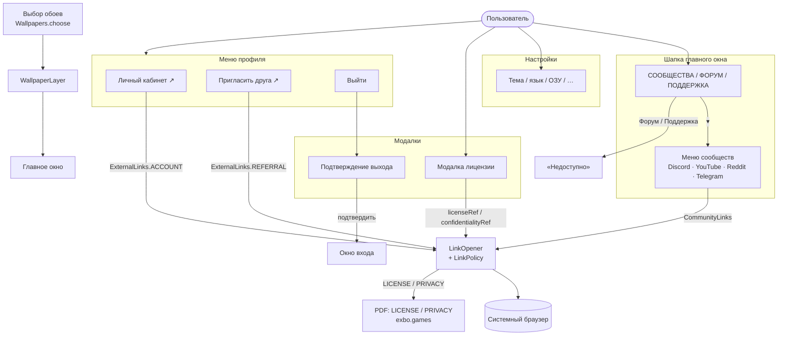

# Диаграмма взаимодействий

Внешние ссылки (меню сообществ, «Личный кабинет», «Пригласить друга», PDF лицензии/политики) идут через
`LinkOpener` и allowlist `LinkPolicy` (`exbo.net`, `exbo.games`, `stalzone.com`, …). «Сменить аккаунт» убран:
назад во вход — только подтверждённый «Выйти». Обои выбирает `Wallpapers.choose` один раз за запуск и рисует
`WallpaperLayer`.

Исходник Mermaid: [`interaction.mmd`](interaction.mmd).

