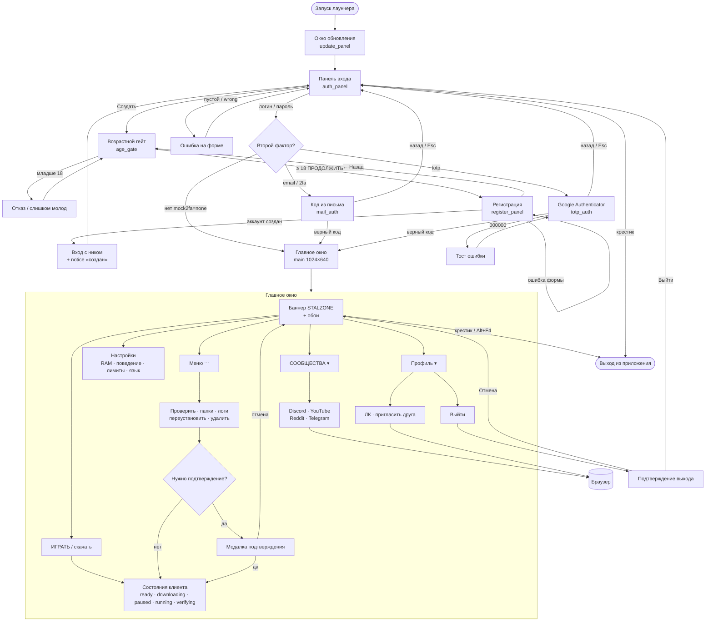

# Маршрут пользователя

Два окна: **pre-main** (обновление 460×316 → вход / регистрация / 2FA, высота по панели, потолок 460×700) и **главное** (игра, настройки, меню).  
Внешние ссылки (сообщества, ЛК, пригласить) — через `LinkOpener` + allowlist `LinkPolicy`.  
Назад во вход только через подтверждённый «Выйти» (отдельного «Сменить аккаунт» нет).

Исходник Mermaid: [`interaction.mmd`](interaction.mmd).

## Диаграмма

## Кратко по веткам

| Ветка | Шаги |
|---|---|
| Счастливый вход | обновление → вход → (опц. 2FA) → главное → ИГРАТЬ |
| Регистрация | вход → Создать → возраст ≥ 18 → форма → notice на входе → пароль |
| Ошибки auth | пустой логин / `wrong` / TOTP `000000` → тост или поле с ошибкой, остаёмся в pre-main |
| Игра | ⋯ или ИГРАТЬ → прогресс / пауза / running / verify / delete с модалками |
| Выход из аккаунта | профиль → Выйти → подтверждение → снова панель входа |
| Выход из приложения | крестик любого окна / Alt+F4 → `Platform.exit()` без вопроса про аккаунт |

На live регистрация аккаунт не создаёт: после формы «Этот лаунчер не создаёт аккаунт. Создайте его на сайте STALZONE.» Предложенное самообновление файл не пишет и показывает «Обновление лаунчера отклонено: нет проверенной подписи.» Mock-ветки таблицы те же.
